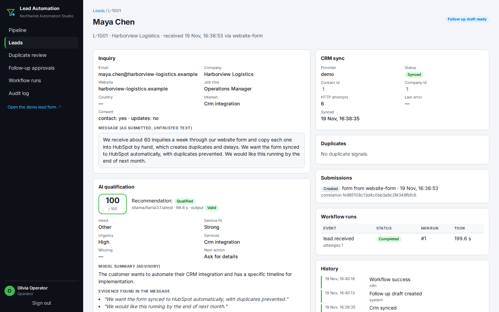
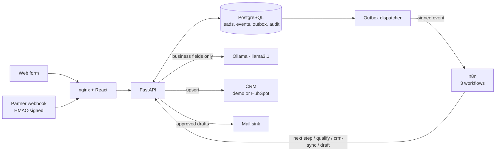
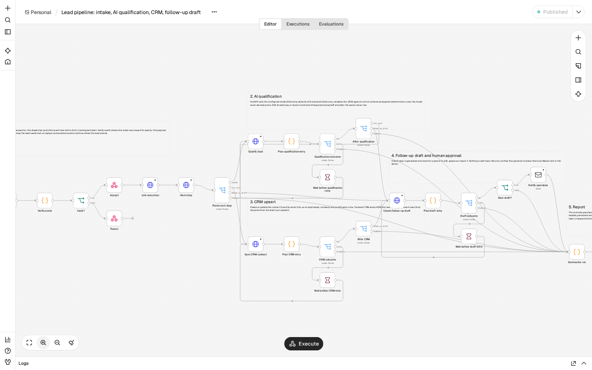
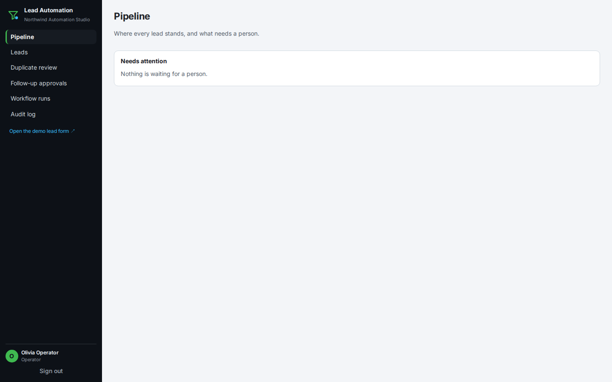
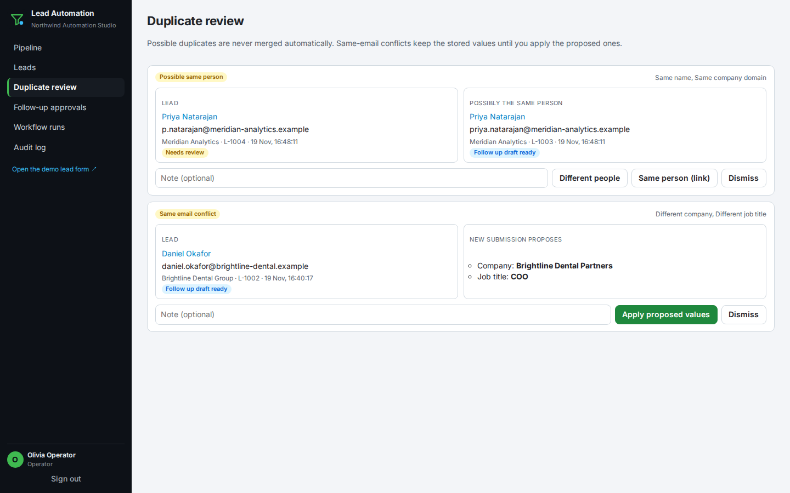
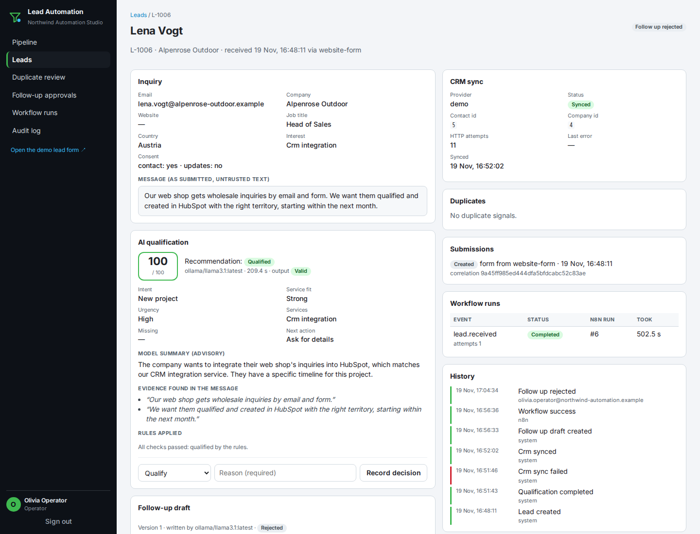
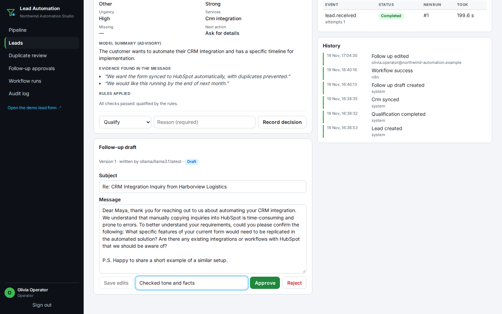

# AI Lead Qualification & CRM Automation

[](https://github.com/ali-fakhrabadi/ai-lead-qualification-crm-automation/actions/workflows/ci.yml)

Inbound leads from a web form or a partner webhook are validated, de-duplicated, qualified by a
language model **plus deterministic business rules**, synced to a CRM, and answered with a
follow-up **draft that a person approves** before anything is sent. FastAPI owns the data and
the decisions; self-hosted **n8n** orchestrates the steps, retries and error handling; the model
runs locally with **Ollama** (OpenAI optional).

> Independent reference project built with synthetic data for a fictional consultancy
> ("Northwind Automation Studio"). It is not client work and contains no real leads.



## The problem

Small B2B teams copy form submissions into the CRM by hand, miss duplicates, answer late, and
either ignore AI or let it act without control. This system does the busywork and keeps people
in charge:

- **No duplicates:** form double-clicks, partner retries and repeated submissions never create a
  second lead, workflow run or CRM contact; conflicting resubmissions and look-alike contacts go
  to a review queue instead of being merged.
- **AI that suggests, rules that decide:** the model returns strict JSON (intent, fit, urgency,
  missing information, evidence quotes); code computes the score and decision; anything
  uncertain, suspicious or not a sales inquiry goes to a person. Leads are never auto-rejected.
- **Nothing is sent without a person:** follow-ups are drafts; an operator edits, approves or
  rejects; delivery goes to a local mail sink in the demo.
- **Failures are visible and recoverable:** transient CRM/model errors are retried with backoff;
  permanent ones stop for an operator; nothing is lost.

## Architecture



Details: [architecture](docs/architecture.md) · [lead lifecycle and rules](docs/lead-lifecycle.md)
· [idempotency and retries](docs/idempotency-and-retries.md) · [n8n workflows](docs/n8n-workflows.md)
· [CRM integration](docs/crm-integration.md) ·
[integration case study](docs/integration-case-study.md) · [security](docs/security.md) ·
[threat model](docs/threat-model.md).

**Stack:** Python 3.12, FastAPI, Pydantic v2, SQLAlchemy 2, Alembic, PostgreSQL 17 · n8n 2.45
with external task runners · Ollama (`llama3.1` 8B) or OpenAI · React 19 + TypeScript + Vite ·
Docker Compose · pytest, Vitest, Playwright, k6 · GitHub Actions.

## Workflow

1. **Intake** (`POST /api/v1/public/leads`, `POST /api/v1/webhooks/leads/{source}`): validate,
   normalise, apply the duplicate rules, store the lead + event + outbox row in one transaction,
   answer `202` with a reference.
2. **Dispatch:** the outbox dispatcher posts a signed event (JWT bound to the payload hash) to n8n.
3. **n8n lead pipeline:** asks the API for the lead's next step and runs qualification → CRM sync →
   draft, each with retries (exponential backoff, jitter, `Retry-After`), then notifies operators
   and reports the outcome. An error workflow reports unexpected failures.
4. **Review:** the operator sees the score, the rules applied, the evidence and the draft; edits,
   approves or rejects; resolves duplicate reviews.
5. **Delivery:** approval triggers the delivery workflow; the API sends the draft once, to the
   configured sink.



## Screenshots

| | |
|---|---|
|  |  |
| Pipeline dashboard | Duplicate review: held for a person, never merged |
|  |  |
| CRM sync after an injected outage was retried | Edit and approve the follow-up draft |

All twelve screenshots with captions: [docs/screenshots.md](docs/screenshots.md). Walkthrough
video: [assets/demo](assets/demo/) (recording notes in [docs/demo](docs/demo/video-recording-notes.md)).

## Results

Measured on the lab deployment with the real model (`llama3.1` 8B, CPU only) over a
128-scenario benchmark, one lead at a time. Full report, raw data and the failures:
[docs/evaluation/benchmark-report.md](docs/evaluation/benchmark-report.md).

| Metric | Result |
|---|---|
| Scenarios passing every check | 126 / 128 |
| Duplicate CRM contacts | 0 (67 leads synced) |
| Repeated deliveries suppressed (webhook retries, double submits, same email) | 22 / 22 |
| Model replies valid against the schema on the first try | 104 / 104 |
| Leads labelled for review that were auto-qualified | 0 / 24 |
| Decisions that agree with the labels (49 new leads, one refused at intake) | 47 / 48 |
| Injected transient CRM/model failures recovered without an operator | 11 / 11 |
| Permanent CRM errors stopped, then fixed with one operator retry | 3 / 3 |
| Messages to leads without a human approval | 0 (8 sent, all approved) |
| Model latency per qualification | p50 35.9 s, p95 69.2 s |
| API (k6, 60 s, 5,318 requests) | 0 failed; lead list p95 110 ms, webhook p95 193 ms |

The run found one real gap: a prompt-injection attempt worded as an order to "the AI model" got
past the pattern check and was auto-qualified (synced and drafted, not sent). The check was
extended, and a re-run of all 8 injection scenarios on the deployed stack held every one for
review. Other test suites: 163 backend tests (89 % coverage), 15 end-to-end scenarios with the
real model, 12 n8n workflow-harness scenarios ([evidence](assets/test-evidence/)).

## Quick start (local)

Requirements: Docker with Compose v2; a model (Ollama with `llama3.1:8b`, or an OpenAI key).

```bash
scripts/init-secrets.sh
```

```bash
cp .env.example .env
```

Set `LEAD_OLLAMA_BASE_URL` (or `LEAD_LLM_PROVIDER=openai` and put the key in
`secrets/openai_api_key`). Without any model, `LEAD_LLM_PROVIDER=fixture` runs the whole flow
with a deterministic stand-in (labelled as such in every assessment).

```bash
docker compose up -d --build --wait
```

```bash
scripts/create-demo-users.sh
```

Open http://localhost:8080 (sign in as `olivia.operator@northwind-automation.example`, password in
`secrets/demo_password`) and the public form at http://localhost:8080/demo-form. The n8n editor
is on http://127.0.0.1:5679 (owner `owner@example.com`, password in
`secrets/n8n_owner_password`), the mail sink on http://127.0.0.1:8025.

**n8n import:** automatic. The `n8n-setup` service imports the three workflows and their
credentials (built from `secrets/`) and publishes them; see [n8n/README.md](n8n/README.md) for
manual import.

**CRM:** the bundled demo CRM by default; `LEAD_CRM_PROVIDER=hubspot` with a private-app token
in `secrets/crm_token` (use a HubSpot test account; not verified against a real account in this
project). See [docs/crm-integration.md](docs/crm-integration.md).

**Model and data transfer:** with Ollama, nothing leaves your network. With OpenAI, the
inquiry's business fields (interest, message, company, job title, domain, country; never name or
email) are sent to OpenAI under your account's terms.

## Tests

| Suite | What | Command |
|---|---|---|
| Backend | 154 unit + integration tests against real PostgreSQL, 89 % coverage (statements + branches) | `cd backend && pytest --cov=app --cov=crm_demo` |
| Frontend | 15 tests (Vitest + Testing Library) | `cd frontend && npm test` |
| n8n Code nodes | 12 tests | `node --test n8n/tests/code_nodes.test.mjs` |
| Workflow harness | the real workflows in a disposable n8n against a scriptable API: 12 scenarios, 49 checks | `n8n/tests/harness/run.sh` |
| End-to-end | the 15 required scenarios + screenshots against the running stack | `e2e/run.sh` |
| Benchmark | 128 synthetic scenarios with the real model | `evals/run.sh` ([methodology](docs/evaluation-methodology.md)) |
| Load | API latency with k6 | `loadtest/run.sh api.js` |

CI runs lint, types, tests with coverage, the workflow harness, dependency audits, gitleaks,
image builds, Trivy and the full end-to-end suite (fixture model) on every push.
Details and measured run times: [CI/CD and deployment](docs/ci-cd-and-deployment.md).

## Deployment

Docker Compose on one host, model optionally on another: [deployment](docs/deployment.md) ·
[CI/CD, backup and rollback](docs/ci-cd-and-deployment.md) ·
[two-host lab deployment](docs/two-host-deployment.md) · backups with `scripts/backup.sh`,
restore checks with `scripts/restore.sh --check`. The lab deployment is LAN-only HTTP (no
domain); put a TLS reverse proxy in front for anything else.

## Security

Signed webhooks with replay protection, signed and payload-bound events to n8n, Argon2id + short
JWT + rotating refresh tokens with reuse detection, roles checked on every request, internal API
unreachable from outside, strict input validation, CSP, hardened read-only containers, internal
network, least-privilege database roles, secrets as files, n8n Code nodes in a separate runner
without credentials, SSRF allow-list, masked logs, audit log, retention purge. Prompt-injection
text is fenced, flagged and cannot trigger any action. See [docs/security.md](docs/security.md).

## Limitations and roadmap

LAN-only HTTP in the lab; HubSpot not verified against a real account; CPU-only model (about a
minute or more per qualification); labels are one operator's judgement on synthetic leads. See
[docs/limitations.md](docs/limitations.md) for the full list and the roadmap.

## Documentation

[API examples](docs/api-examples.md) · [troubleshooting](docs/troubleshooting.md) ·
[evaluation methodology](docs/evaluation-methodology.md) ·
[benchmark report](docs/evaluation/benchmark-report.md) ·
[implementation plan](docs/implementation-plan.md) · [progress log](docs/progress-log.md) ·
[changelog](CHANGELOG.md) · [contributing](CONTRIBUTING.md)

## License

MIT, see [LICENSE](LICENSE). Fonts and libraries keep their own licenses (Inter: SIL OFL 1.1).
