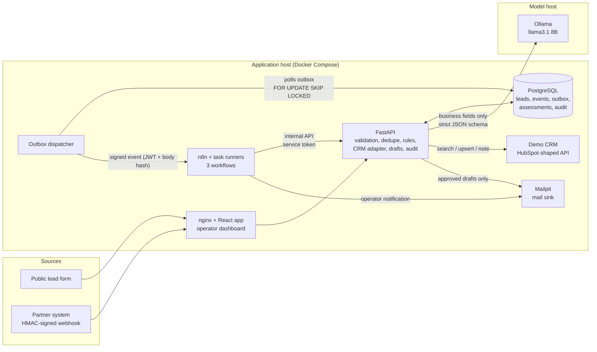

# Architecture

An AI-assisted lead pipeline for a small B2B services company (the fictional *Northwind
Automation Studio*): leads arrive from a web form or a partner webhook, are validated and
de-duplicated, qualified by a language model **plus deterministic business rules**, synced to a
CRM, and answered with a follow-up **draft that a person must approve** before anything is sent.

FastAPI owns the data and every decision. n8n orchestrates the steps, retries and error
handling. The model only ever produces structured, validated suggestions.



## Components

| Component | Responsibility | Notes |
|---|---|---|
| `web` (nginx-unprivileged + React) | Public lead form, operator dashboard, reverse proxy for `/api/` | Blocks `/internal/` (404), 64 KB body limit, CSP and security headers |
| `api` (FastAPI) | Intake, validation, normalization, duplicate rules, lifecycle, qualification, CRM sync, drafts, delivery, audit, auth | Modular monolith in `backend/app`; the only component that writes the application database |
| `dispatcher` | Delivers outbox events to n8n | At-least-once; HS256 token bound to the event id and the payload's SHA-256; backoff with jitter; dead-letter after 8 attempts; re-delivers events n8n never reported on |
| `n8n` + `n8n-runners` | Orchestration: which step runs next, retries with backoff, Wait nodes, error workflow, operator notification | Workflows are generated by `scripts/build_workflows.py`; Code nodes run in the separate runners container (only the `crypto` built-in allowed) |
| `postgres` | Application database (`leads`), n8n database (`n8n`), demo CRM database (`crm_demo`) | Separate least-privilege roles; never published |
| `crm-demo` | Stand-in CRM with a HubSpot-shaped API subset | Separate database and token; optional fault injection for tests only |
| `mailpit` | Captures every outgoing message | Nothing is delivered to a real mailbox |
| Ollama (model host) | Qualification and drafting inference | Reached over the private LAN; no data leaves the lab |

## Request flow (new lead)

1. The form (or a partner webhook) posts to `/api/v1/public/leads` or
   `/api/v1/webhooks/leads/{source}`. Webhooks are verified with HMAC-SHA256 over
   `timestamp.body` (5-minute tolerance) and rate limited per IP and per source.
2. FastAPI validates and normalizes the submission, applies the duplicate rules
   ([idempotency-and-retries.md](idempotency-and-retries.md)), and stores the lead, the raw event
   and an outbox row **in one transaction**. The caller gets `202 Accepted` with a reference.
3. The dispatcher claims the outbox row and posts a signed envelope (identifiers only, no lead
   data) to the n8n webhook.
4. The **lead pipeline** workflow verifies the token and envelope, links its execution id to the
   event, asks the API for the lead's next step and runs it:
   `qualify → crm-sync → follow-up-draft`, each through an internal endpoint. Transient answers
   (connection error, 429, 5xx) are retried with exponential backoff, full jitter and
   `Retry-After`; permanent answers (4xx) stop the run for an operator.
5. Qualification: the API sends only business fields (interest, message, company, job title,
   domain, country) to the model with a strict JSON schema, validates the reply (one repair
   attempt), grounds evidence quotes in the message, and computes the score and decision with
   deterministic rules ([lead-lifecycle.md](lead-lifecycle.md)).
6. CRM sync: search the contact by email, update or create it, find or create the company by
   domain, associate them and add one qualification note per assessment
   ([crm-integration.md](crm-integration.md)).
7. A follow-up draft is generated (model or template) and an operator notification goes to the
   mail sink. **Nothing is sent to the lead.**
8. An operator edits, approves or rejects the draft in the dashboard. Approval writes a
   `follow_up.approved` outbox event; the **follow-up delivery** workflow asks the API to deliver
   it, which sends it to the mail sink once (idempotent).
9. Each run reports its outcome (`success`, `stopped`, `error`) to the API. Unexpected failures
   go to the **error handler** workflow, which reports the execution id; the API marks the lead
   `retry_pending` at the stage it reached and re-delivers the event with backoff.

## Why this shape

- **The database is the source of truth, n8n is the conductor.** n8n holds no lead data; it
  receives identifiers and asks the API what to do. A replayed or resumed event therefore
  continues where the lead stands instead of repeating work.
- **Transactional outbox** instead of calling n8n from the request: a crash between "lead saved"
  and "workflow started" cannot lose a lead, and n8n being down only delays processing.
- **Rules decide, the model suggests.** The model classifies intent, fit, urgency and missing
  information; the score and decision come from code that is unit tested and can be audited. The
  rules never reject a lead automatically: anything uncertain goes to a person.
- **No Redis.** n8n runs in regular mode, the outbox is polled with `SKIP LOCKED`, and rate
  limits are PostgreSQL counters: one fewer stateful service to secure and back up at this scale.

## Technology

Python 3.12, FastAPI, Pydantic v2, SQLAlchemy 2, Alembic, psycopg 3, PyJWT, argon2-cffi, httpx ·
PostgreSQL 17 · n8n 2.45.6 with external task runners · React 19, TypeScript, Vite · nginx
(unprivileged) · Ollama with `llama3.1` 8B (OpenAI optional) · Mailpit · Docker Compose ·
pytest, Vitest, Playwright, k6 · GitHub Actions, gitleaks, pip-audit, npm audit, Trivy.

## Code map

```
backend/app/api/v1/       public (form, webhooks), operator (dashboard API), internal (n8n)
backend/app/services/     intake, lifecycle, qualification, crm_sync, followups, pipeline, outbox, auth, audit
backend/app/qualification rubric, prompt, schema, rules, providers (ollama, openai, fixture)
backend/app/crm/          HubSpot-style client with retries, property mapping
backend/app/dispatcher/   outbox dispatcher
backend/crm_demo/         the demo CRM service
n8n/code/                 Code node scripts (unit tested with node --test)
n8n/workflows/            generated workflow exports (no credential values)
n8n/setup/                one-shot importer: credentials from secrets, workflows, publish
n8n/tests/harness/        workflow harness: disposable n8n + scriptable API stub
frontend/src/             React app
e2e/                      Playwright end-to-end scenarios against a running stack
evals/                    benchmark dataset builder, harness, metrics
loadtest/                 k6 latency test
```
