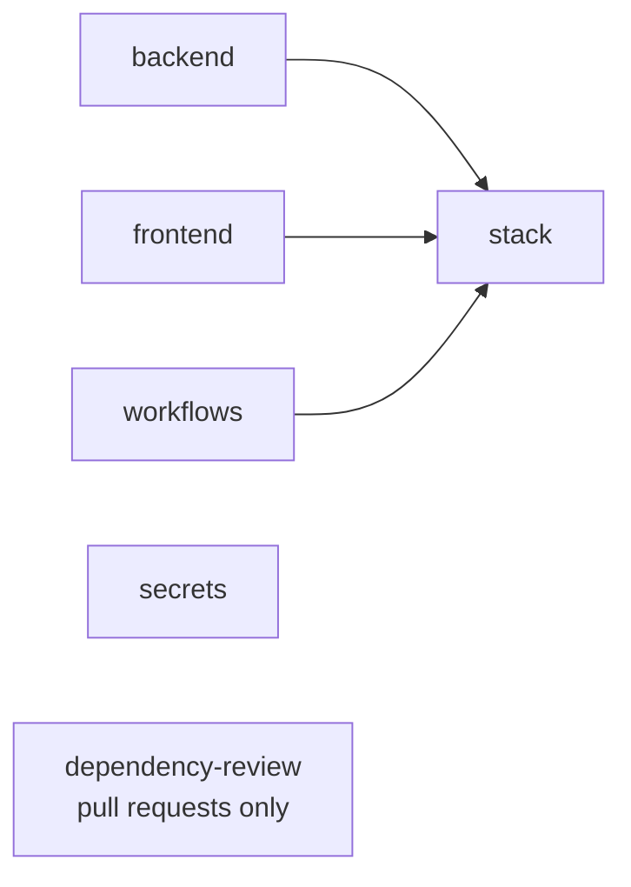

# CI/CD and deployment

How a change gets from a commit to a running stack: what CI checks on every push, how the images
are built, how the stack is deployed with Docker Compose, and how it is backed up, restored and
rolled back. The results quoted are from real runs: the GitHub Actions run of commit `3318a41`
and the lab deployment recorded in [two-host-deployment.md](two-host-deployment.md).

**Scope, stated plainly:** CI is fully automated. Deployment is a scripted, documented manual
step on the host (`docker compose up -d --build --wait`); there is no image registry and no
automatic deploy from CI. For a single-host lab install that is a deliberate choice (the images
are built where they run, from a checked-out commit); the last section lists what changes for a
registry-based pipeline.

## 1. Continuous integration

Workflow: [`.github/workflows/ci.yml`](../.github/workflows/ci.yml). Triggers: every push to
`main`, every pull request, manual dispatch. A newer push to the same ref cancels the older run.

Supply-chain rules applied to the workflow itself:

- `permissions: contents: read` for the whole workflow; checkout with `persist-credentials: false`;
- every action pinned to a full commit SHA (version in a comment);
- tool images (Trivy, gitleaks) and service images (PostgreSQL) pinned by digest;
- Python dependencies installed with `--require-hashes`, npm with `npm ci --ignore-scripts`.

### Jobs



| Job | Steps |
|---|---|
| **backend** | PostgreSQL 17 service; least-privilege roles created with the deployment's own init script (`deploy/postgres/initdb/10-create-roles.sh`) and throwaway passwords masked in the log; `ruff check` + `ruff format --check` over backend, e2e, evals, scripts and the workflow harness; `mypy`; unit + integration tests against the real database as the application role, **coverage gate 85 %**; `pip-audit --strict` on the locked requirements; benchmark metric unit tests; the evaluation dataset is regenerated and compared (`build_dataset.py --check`) and checked to use only reserved `.example` domains |
| **frontend** | `npm ci`; type check; Vitest with coverage; production build; `npm audit --omit=dev --audit-level=high` |
| **workflows** | the committed n8n workflow JSON must equal what `scripts/build_workflows.py` generates; Code node unit tests (`node --test`); the **workflow harness**: the real workflows imported into a disposable n8n and run against a scriptable API (replays, CRM `429` with `Retry-After`, CRM outage, permanent CRM error, model outage, invalid model output, refused tokens, error workflow, delivery replay); report uploaded as an artifact |
| **secrets** | gitleaks over the **full git history**, redacted output, fails on any finding |
| **dependency-review** | on pull requests: fails on new dependencies with a HIGH vulnerability or a GPL-3.0/AGPL-3.0 license |
| **stack** (after backend, frontend, workflows) | throwaway secrets (`scripts/init-secrets.sh`) and `.env`; `docker compose config`; build the images; **Trivy** scan of `lead-automation-api` and `lead-automation-web`: any fixed HIGH/CRITICAL vulnerability fails the build; `docker compose up -d --wait` (every container healthy), `/api/ready`, demo users; the **15 end-to-end scenarios** plus screenshot tests with Playwright; screenshots and report uploaded; container logs on failure |

The stack job uses the evaluation overlay (`compose.eval.yaml`, fault injection on) and the
deterministic `fixture` model provider, because CI has no model server; every assessment made
by the fixture is labelled as such. The real model is measured separately on real hardware
([benchmark](evaluation/benchmark-report.md)).

### Measured run

GitHub Actions run of commit `3318a41` (2026-11-19), all jobs green:

| Job | Result | Duration |
|---|---|---|
| Frontend | success | 24 s |
| Backend | success | 56 s |
| Secret scan | success | 12 s |
| n8n workflows + harness | success | 3 min 37 s |
| Containers: build, Trivy, full stack, end-to-end | success | 5 min 26 s |
| Dependency review | skipped (push, not a pull request) | |

About 13 minutes from push to the last job, most of it the stack job waiting for the other three.

What CI caught during the project (from the [changelog](../CHANGELOG.md)): Trivy found 6 fixed
HIGH/CRITICAL findings in the web image's nginx packages (fixed by upgrading nginx from nginx.org's
signed repository); the stack job found that `docker compose up --wait` failed because the
dispatcher had no health check (it now writes a heartbeat).

### Local equivalents

| CI step | Locally |
|---|---|
| backend tests | `cd backend && pytest` (needs PostgreSQL; see [CONTRIBUTING](../CONTRIBUTING.md)) |
| frontend | `cd frontend && npm run typecheck && npm run test:coverage && npm run build` |
| workflows | `python3 scripts/build_workflows.py --check`, `node --test n8n/tests/code_nodes.test.mjs`, `n8n/tests/harness/run.sh` |
| full stack | `docker compose -f compose.yaml -f compose.eval.yaml up -d --build --wait`, then `e2e/run.sh` |

## 2. Image builds

| Image | Built from | Notes |
|---|---|---|
| `lead-automation-api:local` | [`backend/Dockerfile`](../backend/Dockerfile) | Python 3.12 slim base pinned by digest; Debian security updates applied at build; dependencies in a venv from hash-checked requirements (`deps` stage); a separate `dev` stage adds the test tools and is never shipped; runtime as UID 10001, health check on `/api/health`. The same image runs `api`, `migrate`, `dispatcher` and `crm-demo` |
| `lead-automation-web:local` | [`frontend/Dockerfile`](../frontend/Dockerfile) | Node 22 build stage (`npm ci`, type check, Vite build); runtime is `nginx-unprivileged` pinned by digest, Alpine packages upgraded, nginx upgraded to the fixed version from nginx.org's signed repository, unused dynamic modules removed, `nginx -t` at build |
| third-party | pinned by digest in `compose.yaml` | PostgreSQL 17.11, n8n 2.45.6, n8n runners 2.45.6, Mailpit 1.29.6, Ollama 0.12.9 (optional profile) |

Package mirrors can be set at build time (`PIP_INDEX_URL`, `NPM_REGISTRY`); the hashes and the
lock file's integrity values are checked either way.

## 3. Deployment with Docker Compose

Full install guide: [deployment.md](deployment.md). The short version:

```bash
scripts/init-secrets.sh
```

```bash
cp .env.example .env
```

```bash
docker compose up -d --build --wait
```

```bash
scripts/create-demo-users.sh
```

```bash
e2e/smoke.sh
```

What the stack enforces on start:

- order: `postgres` healthy → `migrate` (one-shot `alembic upgrade head` as the schema owner) →
  `api`, `dispatcher`; `n8n-setup` imports and publishes the workflows idempotently;
- every service has a health check, so `--wait` returns only when all are healthy;
- containers are read-only, drop all capabilities and run with `no-new-privileges`; only `web`
  is published (n8n editor and Mailpit UI on loopback);
- secrets are files under `secrets/`, mounted as Docker secrets, never environment values;
- with `LEAD_ENVIRONMENT=production` the API refuses to start with missing or short secrets,
  with fault injection on, or with real SMTP recipients not explicitly allowed.

`e2e/smoke.sh` sends one synthetic lead through the deployed stack: replay recognised, identical
resubmission ignored, one workflow run, one CRM contact, no message before approval.

### Lab deployment record

From [two-host-deployment.md](two-host-deployment.md), run on 2026-11-19 (21:52-22:04 UTC) on lab
host 24.179, with the model on lab host 24.176:

| Check | Result |
|---|---|
| Commit and images | `8aace5c`; `lead-automation-api:local` (`sha256:e82e2f03…`) and `lead-automation-web:local` (`sha256:0954b0cc…`) built on the host |
| Configuration | `compose.yaml` only, `LEAD_ENVIRONMENT=production`, fault injection off, delivery to the sink |
| Exposure (`ss` and `curl` from the host) | web on the LAN interface (health 200); n8n editor and Mailpit UI on 127.0.0.1 only; PostgreSQL, API, n8n webhooks and demo CRM not published |
| Smoke test | passed; the lead was qualified with a model-written draft in under 9 minutes on the shared CPU model host |

## 4. Backup and restore

```bash
scripts/backup.sh
```

Online (no downtime): `pg_dump -Fc` of the three databases (`leads`, `n8n`, `crm_demo`) into
`backups/<UTC stamp>/`, row counts of the main tables, and `SHA256SUMS`, written with `umask 077`.
The dumps hold personal data and n8n's encrypted credentials: store them encrypted, and keep
`secrets/n8n_encryption_key` backed up separately.

```bash
scripts/restore.sh --check backups/<stamp>
```

Verifies the checksums, restores each dump into a scratch database and compares row counts with
the backup, without touching live data. Run it on every backup you intend to rely on.
`scripts/restore.sh backups/<stamp>` replaces the live databases: it asks first, stops the
writers, restores with the original owners, runs migrations and starts the stack.

**Measured on the lab host:** three dumps with checksums; restored into scratch databases with
equal row counts (118 leads, 131 lead events, 771 audit events, 129 outbox events), 3 n8n
workflows, 68 CRM contacts.

## 5. Upgrade and rollback

Upgrade:

```bash
scripts/backup.sh
```

```bash
for i in api web; do docker tag lead-automation-$i:local lead-automation-$i:rollback; done
```

```bash
git fetch && git checkout <new tag>
```

```bash
docker compose build && docker compose up -d --wait
```

Rollback to the saved images, without rebuilding:

```bash
LEAD_API_IMAGE=lead-automation-api:rollback LEAD_WEB_IMAGE=lead-automation-web:rollback docker compose up -d --wait
```

`compose.yaml` reads `LEAD_API_IMAGE` and `LEAD_WEB_IMAGE` (default `:local`), so the switch is
one command. If the new version ran a migration, restore the pre-upgrade backup, or run
`alembic downgrade` to the previous revision first (every migration has a downgrade). Check out
the previous commit too, so its `n8n-setup` re-imports the previous workflows.

**Measured on the lab host:** the running images were tagged `:rollback`, the stack started on
them (all containers healthy, web health 200), then back on `:local` (all healthy, health 200).
Both tags held the same build, so this test verifies the procedure and the one-command switch,
not a change between two versions.

## 6. Moving to a registry-based pipeline

What would change for a team with a registry and several environments (not built in this
project):

- the stack job pushes the scanned images to a registry, tagged with the commit SHA, and records
  their digests;
- deployment pulls by digest (`LEAD_API_IMAGE=registry/…@sha256:…`) instead of building on the
  host; rollback becomes "deploy the previous digest";
- a protected environment in GitHub Actions with manual approval runs the deploy over SSH and
  then `e2e/smoke.sh`, rolling back automatically if the smoke test fails;
- a scheduled job runs `scripts/backup.sh` and `scripts/restore.sh --check` and alerts on failure.
