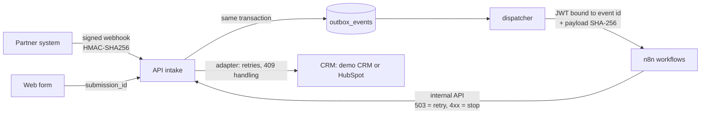

# Case study: the integration layer

This project is a lead-qualification system, but most of its code is integration work: taking
events from outside systems, passing them between services that can fail independently, and
writing into a third-party CRM without creating duplicates. This page describes that layer as it
is built, with the numbers measured in the [benchmark](evaluation/benchmark-report.md). Nothing
here is planned work presented as done; where something was not verified, the page says so.

## The problem

A lead arrives from a website form or a partner system's webhook. It has to be checked,
qualified by a model, written to the CRM as one contact (with its company and a note), and turned
into a follow-up draft that a person approves. Every hop can fail or repeat:

- partners retry webhooks, browsers double-submit forms;
- the workflow engine (n8n) restarts mid-run, and the dispatcher delivers events at least once;
- the CRM answers `429`, `5xx`, times out, or rejects a token;
- two writers can try to create the same contact at once.

The requirement was: **no lost leads, no duplicate CRM records, no message sent twice, and every
failure either recovered automatically or shown to an operator with a reason.**

## Architecture of the layer



| Piece | Code |
|---|---|
| Webhook signature check | [`backend/app/services/webhooks.py`](../backend/app/services/webhooks.py) |
| Intake idempotency and duplicate rules | [`backend/app/services/intake.py`](../backend/app/services/intake.py) |
| Transactional outbox | [`backend/app/services/outbox.py`](../backend/app/services/outbox.py) |
| Dispatcher (outbox → n8n) | [`backend/app/dispatcher/main.py`](../backend/app/dispatcher/main.py) |
| n8n event check and retry planning | [`n8n/code/verify_event.js`](../n8n/code/verify_event.js), [`n8n/code/plan_retry.js`](../n8n/code/plan_retry.js) |
| CRM adapter | [`backend/app/crm/client.py`](../backend/app/crm/client.py) |
| Field mapping | [`backend/app/crm/mapping.py`](../backend/app/crm/mapping.py) |
| CRM sync service | [`backend/app/services/crm_sync.py`](../backend/app/services/crm_sync.py) |
| Demo CRM (HubSpot-shaped API subset) | [`backend/crm_demo/app.py`](../backend/crm_demo/app.py) |

## 1. Inbound: HMAC-signed webhooks

`POST /api/v1/webhooks/leads/{source}`. Each source has its own shared secret (a secret file,
never an environment variable in the repository). The sender signs `"{timestamp}.{raw body}"`:

```http
X-Lead-Timestamp: 1763560000
X-Lead-Signature: v1=<hex HMAC-SHA256>
```

What the check does, in order:

1. Unknown source → `404`, the same answer as a missing route, so sources cannot be probed.
2. Missing header or a non-integer timestamp → `401 invalid_signature`.
3. Timestamp more than 300 s from the server clock (`LEAD_WEBHOOK_TOLERANCE_S`) →
   `401 expired_signature`: a captured request cannot be replayed later.
4. The digest is compared in constant time (`hmac.compare_digest`). The header may hold several
   comma-separated signatures, so a partner can rotate its secret without downtime.
5. Only then is the body parsed and validated; the per-source rate limit is counted after the
   signature, so unsigned traffic cannot use up a partner's quota.

Every rejection is written to the audit log with its reason. A replay **inside** the 300 s window
passes the signature check and is then answered from the idempotency record (next section).

Measured: 43 webhook requests in the benchmark, 38 accepted; the 5 rejections were `401` × 2,
`404` × 1, `409` × 2, and **3 / 3** unauthenticated webhooks were refused. Webhook intake latency
on the lab host: p50 28.9 ms, p95 39.7 ms.

## 2. Idempotency

Delivery is at-least-once at every hop, so every step is written to be safe when it runs twice.

**At intake.** The key is `(source, event_id)` for webhooks and `(website-form, submission_id)`
for the form (a random id per filled-in form; a content hash if the client sends none). The pair
is unique in the database.

| Situation | Answer |
|---|---|
| Same key, same payload | `202`, `replayed: true`, the original reference; no new event, no new workflow run |
| Same key, different payload | `409 idempotency_conflict`: an id must never mean two things |
| Same key arriving concurrently | the unique index wins; the loser is answered like a replay |
| New key, same email | the duplicate rules apply (ignore, update, or hold for review; never silently overwrite) |

**Between services.** The business change and its outbox event are written in one transaction,
so a lead can never exist without the event that processes it, and an event never exists for a
change that was rolled back. The dispatcher sends identifiers only; n8n asks the API for the
lead's next step, so a re-delivered event resumes where the lead stands instead of starting over.

**At the CRM.** A sync searches the contact by email before creating anything. A create that
races with another writer gets HubSpot's `409 Contact already exists. Existing ID: …`; the
adapter reads the id from the message and updates that contact instead. A hash of the mapped
properties skips an update when nothing changed, and a note is written once per assessment.

Measured: **22 / 22** repeated deliveries (webhook replays, form double submits, same-email
resubmissions) were suppressed, and there were **0 duplicate CRM contacts** across the 67 leads
that reached the CRM (the demo CRM enforces a unique email, as HubSpot does, and the benchmark
counted duplicate emails afterwards: 0).

## 3. Event delivery to the workflow engine

The dispatcher claims due events with `SELECT … FOR UPDATE SKIP LOCKED`, so several dispatchers
can run without delivering the same event twice at once, and commits after each event, so a
crash never loses a delivery result.

Each delivery carries a JWT (HS256, 5-minute expiry, issuer `lead-automation-dispatcher`,
audience `n8n`) whose claims include the event id and the SHA-256 of the exact payload string.
n8n's webhook node checks the signature and expiry; the first Code node checks issuer, audience,
the payload hash and the event id. A captured token is useless with any other body.

## 4. Retries with backoff, in three layers

| Layer | Retried | Policy (from the code) |
|---|---|---|
| CRM adapter, per HTTP call | timeout, connection error, `429`, `5xx` | up to 3 attempts; wait is full jitter `uniform(0, min(4 s, 0.5 s × 2^(attempt-1)))`, or `Retry-After` capped at 4 s |
| n8n step, per API call | connection error, `429`, `5xx` | 3 attempts per run; wait between half and all of `base × 2^(attempt-1)`, at least `Retry-After`, at most 60 s; base 20 s for model steps, 10 s for CRM sync and delivery |
| Dispatcher, per event | n8n unreachable or non-2xx | up to 8 attempts; wait between half and all of `min(300 s, 2 s × 2^attempts)`; then `dead`, shown on the dashboard |
| Lost run | dispatched, never reported back | delivered again after 15 minutes |

The layers are bounded so they do not multiply into a storm: the adapter's retries are short (at
most a few seconds inside one API request); if the CRM is still failing, the API answers n8n
`503 crm_unavailable` with `Retry-After: 15`, and n8n waits at the workflow level; if a run
exhausts its attempts, the event goes back to the dispatcher's longer backoff.

All limits are settings (`LEAD_CRM_MAX_ATTEMPTS`, `LEAD_CRM_BACKOFF_BASE_S`,
`LEAD_CRM_BACKOFF_CAP_S`, `LEAD_DISPATCH_*`), validated with upper bounds at start-up.

## 5. Transient versus permanent errors

The classification is the core of the design: retrying a permanent error wastes time and can make
things worse (an expired token retried 8 × 3 × 3 times), while giving up on a transient one loses
leads.

| CRM answer | Class | Error code | Outcome |
|---|---|---|---|
| timeout | transient | `timeout` | retried as above |
| connection error | transient | `unreachable` | retried |
| `429` | transient | `rate_limited` | retried, honouring `Retry-After` |
| `5xx` | transient | `server_error` | retried |
| `401` | permanent | `unauthorized` | stop, lead `failed`, operator fixes the token and presses **Retry** |
| `403` | permanent | `forbidden` | stop (missing scope) |
| `404` | permanent | `not_found` | stop |
| other `4xx` | permanent | `rejected` | stop (e.g. a property that does not exist in the portal) |
| `409` on create without an id in the message | permanent | `conflict` | stop |

The same rule is applied by the API towards n8n (`503` = try again later, `409`/`422` = stop and
report) and by n8n's retry planner, so one decision travels through all layers. Every HTTP attempt
is stored in `crm_attempts` (operation, outcome, status, duration, error) and shown on the lead
page; the sync record keeps the remote ids, the attempt count and the last error code.

Measured (faults injected into the demo CRM and the model through the evaluation overlay):

| | Result |
|---|---|
| Transient CRM and model failures recovered without an operator | **11 / 11** |
| Permanent CRM errors (`401`, `403`, `4xx`) that stopped for a person, then recovered with one retry | **3 / 3** |
| CRM HTTP calls logged / failed by injection | 579 / 18 |
| CRM sync operations succeeded / failed | 67 / 5 (all 5 failures injected) |
| Receipt → done for a lead with an injected transient failure | p50 57.8 s, p95 103.0 s (n = 11) |
| Receipt → CRM sync, clean leads | p50 41.0 s, p95 43.4 s (n = 40; almost all of it is model inference) |

## 6. The CRM adapter

`HubSpotStyleClient` speaks the HubSpot CRM v3/v4 shape: search contact by email, create,
update, search or create company by domain, associate contact and company (v4 default
association), add a note associated with the contact (type 202). It knows nothing about leads:
it takes properties and ids and returns ids. Two injection points make it testable without a
network:

- `transport`: any `httpx` transport; the unit tests pass an in-memory fake CRM
  (`backend/tests/unit/test_crm_client.py`) with scripted failures per operation;
- `sleep`: the tests replace it, so retry tests run instantly and assert the waits.

Mapping is separate ([`mapping.py`](../backend/app/crm/mapping.py)): standard properties, custom
`lq_*` properties and constants, replaceable with a JSON file (`LEAD_CRM_PROPERTY_MAP_FILE`) for
portals that name fields differently. The note holds the decision, score and a short summary,
never the lead's raw message.

The bundled demo CRM implements the subset of the API the adapter uses (unique email like
HubSpot, `409` with the existing id, bearer token, its own database), plus admin endpoints for
fault injection and counts that are enabled only in the evaluation overlay. That is what lets the
whole pipeline, the tests and the benchmark run with no external account.

**Not verified:** the adapter has **not** been run against a real HubSpot account (no sandbox
credentials were available). Request shapes follow HubSpot's public API and are exercised
against the demo CRM only.

## 7. How a new connector plugs in

The sync service ([`crm_sync.py`](../backend/app/services/crm_sync.py)) is the only caller of
the adapter, and it uses six methods:

```python
find_contact(email) -> str | None
create_contact(properties) -> str          # resolves a create race to the existing id
update_contact(contact_id, properties) -> None
find_company(domain) -> str | None
create_company(name, domain) -> str
associate(contact_id, company_id) -> None
add_note(contact_id, body, timestamp_iso) -> str
```

and one error contract: raise `CrmError(transient=..., code=..., http_status=...)`, and call the
`record(operation, outcome, status, ms, error)` callback once per HTTP attempt. Everything around
it (locking the lead, the payload hash, one note per assessment, storing attempts, the lead's
state transitions, the `503`/`422` answers to n8n, the dashboard) stays the same.

Adding a connector today means:

1. A client class with those methods, built on `httpx` with the same `transport`/`sleep`
   injection, mapping the target system's status codes onto transient/permanent.
2. A provider value in `LEAD_CRM_PROVIDER` (`backend/app/core/config.py`) and a branch in
   `make_client` (`crm_sync.py`).
3. A property map for the target's field names.
4. A local mock of the target's API, like the demo CRM, so the integration and end-to-end tests
   run without an account, and unit tests with a fake transport for the retry and conflict paths.

The interface is implicit today (one implementation); a second connector is the point at which
it would be written down as a `Protocol` and the provider switch turned into a small registry.
"Contact" and "company" also map differently in non-CRM systems (an accounting system has
customers, a store has customers and orders), so the method names would become the generic
operations the sync needs: upsert a person, upsert an organisation, link them, attach a note.

## 8. How it is verified

| Suite | What it covers for this layer | Result |
|---|---|---|
| Backend unit + integration (real PostgreSQL) | signatures and expiry, idempotency keys and conflicts, same-email rules, outbox claims, CRM retries and `Retry-After`, `409` resolution, permanent errors not retried | 163 passed, 89 % coverage |
| n8n workflow harness (disposable n8n, scriptable API) | replays, CRM `429` with `Retry-After`, CRM outage exhausting attempts, permanent CRM error, refused tokens, error workflow, delivery replay | 12 / 12 scenarios, 49 / 49 checks |
| End-to-end (deployed stack) | replays, duplicate submissions, injected failures, through the browser and the real model | 21 passed |
| Benchmark (128 scenarios, real model) | the numbers on this page | 126 / 128 passed every check; the two failures are unrelated to integration ([findings](evaluation/benchmark-report.md#findings)) |

CI runs the unit, integration, harness and end-to-end suites on every push; see
[ci-cd-and-deployment.md](ci-cd-and-deployment.md).

## Limits

- One connector (HubSpot-shaped), not verified against a real HubSpot account.
- The benchmark processed one lead at a time; throughput with concurrent leads was not measured
  through the model. API concurrency was load-tested with k6 (5,318 requests, 0 failed).
- Outbound delivery goes to a local mail sink only; no real recipients.
