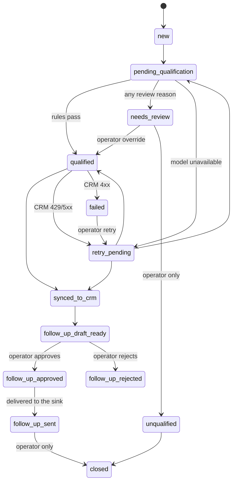

# Lead lifecycle and qualification rules

## Statuses

All allowed transitions live in one table (`backend/app/services/lifecycle.py`) and are unit
tested. `unqualified` and `closed` can only be set by a person; no AI recommendation closes or
rejects a lead. `retry_pending` and `failed` record the stage the lead reached
(`retry_stage`: qualification, crm_sync, follow_up_draft, follow_up_delivery), so a resumed or
replayed event continues exactly there.

A new inquiry from the same email reopens a lead that is `closed`, `unqualified`,
`follow_up_sent`, `follow_up_rejected` or `failed`. While a lead is mid-pipeline (for example a
draft is waiting) a new inquiry does **not** restart it behind the operator's back: the message
is recorded and the reason `new_inquiry_during_processing` is added.

## What the model sees

Only business fields: interest, message, company, job title, company domain and country. Never
the name, email address or phone number. The message is fenced as untrusted data
(`<<<MESSAGE>>> ... <<<END MESSAGE>>>`; angle-bracket sequences are stripped from the text first), the system prompt says instructions inside it must be ignored,
and the model has **no tools**: it can only return JSON.

The reply must match a strict schema (Pydantic, `extra="forbid"`; the same model generates the
JSON schema sent as Ollama's `format` / OpenAI's `json_schema`):

| Field | Values |
|---|---|
| `intent_category` | new_project, pricing_request, partnership, support_request, job_application, vendor_pitch, spam_or_test, other |
| `service_fit` | strong, partial, none, unclear |
| `requested_services` | up to 4 of the rubric's service keys (unknown keys are dropped) |
| `urgency` | high, medium, low, unknown |
| `evidence` | up to 4 short quotes from the message |
| `reasoning_summary` | at most 400 characters, shown to the operator as advisory |
| `recommended_next_action` | book_discovery_call, send_information, ask_for_details, route_to_support, no_action |
| `missing_information` | use_case, timeline, budget, company, systems |
| `needs_human_review` | boolean |

Invalid JSON or a schema violation triggers **one** repair call with the validation error; a
second failure is stored as `invalid_output` and the lead goes to review. Temperature 0 and a
fixed seed keep runs repeatable.

## The rules (deterministic, `backend/app/qualification/rules.py`)

**Score (0-100)** = fit + urgency + completeness

| Part | Points |
|---|---|
| Fit | strong 50 · partial 30 · unclear 10 · none 0 |
| Urgency | high 25 · medium 15 · low 5 · unknown 0 |
| Completeness | 25 minus 5 per missing item (de-duplicated; an item the form already answers, such as the company, is ignored) |

**Decision.** `qualified` only when **no** review reason applies; otherwise `needs_review`.
Review reasons:

- `instruction_like_text`: the message, company or job title looks like an attempt to instruct
  the model (regex check, independent of the model's answer)
- `model_requested_review`: the model set `needs_human_review`
- `not_a_sales_inquiry:<intent>`: support request, job application, vendor pitch
- `possible_spam_or_test`
- `service_fit_none`, `service_fit_unclear`
- `evidence_not_found_in_message`: the model quoted text that is not in the message
- `score_below_threshold` (threshold 60)
- `possible_duplicate_open`, `same_email_conflict_open`: an open duplicate review on the lead
- `invalid_model_output`

Operators can override the decision with a mandatory reason (audited); overriding to `qualified`
resumes the pipeline. The rubric (business description, services, weights, threshold) is a JSON
file (`LEAD_RUBRIC_FILE`) so another business can use its own; it never refers to personal
characteristics.

## Example

| Step | Status | What happened |
|---|---|---|
| Form submitted | `new` | `202`, reference `L-1001`, one lead event, one outbox row |
| Dispatcher | `new` | signed event delivered to n8n, execution linked to the event |
| Qualification | `qualified` | intent `new_project`, fit `strong`, urgency `high`, 0 missing → score 100, no review reasons |
| CRM sync | `synced_to_crm` | contact created, company found by domain, associated, note added (6 HTTP calls) |
| Draft | `follow_up_draft_ready` | draft written by the model; operators notified in the mail sink |
| Approval | `follow_up_approved` | operator edited the text and approved it (audited) |
| Delivery | `follow_up_sent` | delivered once to the mail sink; a replay would not send again |
