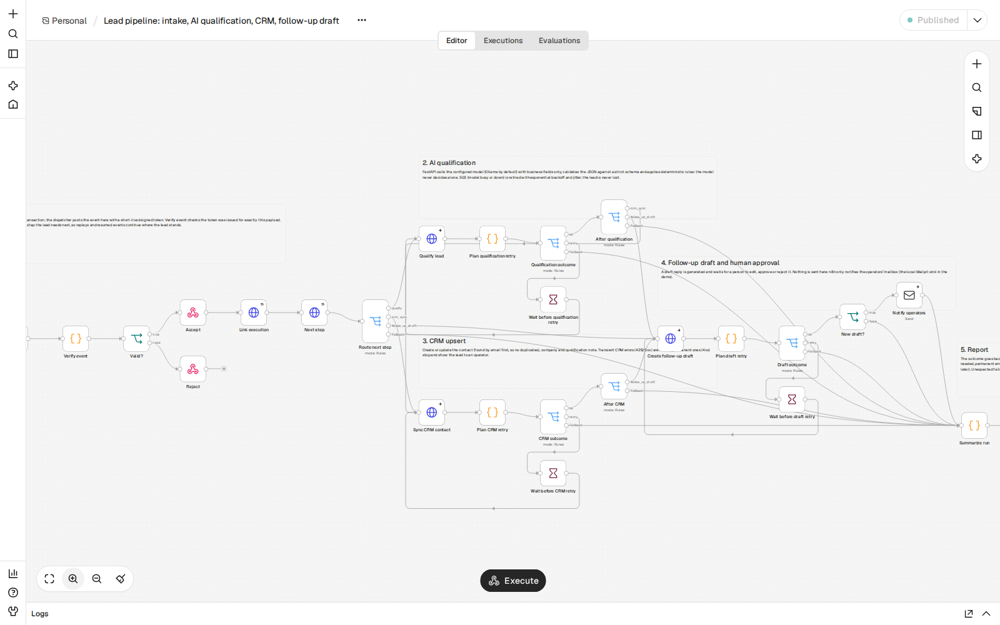

# n8n workflows

Three workflows, generated from one definition (`scripts/build_workflows.py`) with the Code
node scripts in `n8n/code/`. The exports in `n8n/workflows/` contain **no credential values**:
nodes refer to credentials by fixed id and name, and the setup service creates them from Docker
secrets.

## 1. Lead pipeline (`leadPipeline0001`, webhook `POST /webhook/lead-events`)

| Node(s) | What it does |
|---|---|
| Lead event webhook | JWT auth credential: HS256 signature and expiry of the dispatcher's token |
| Settings | API URL, operator mailbox, sender, dashboard URL (set by the setup service) |
| Verify event | Issuer and audience, `payload_sha256` claim equals the SHA-256 of the received payload string, event id matches the `eid` claim, envelope well formed, event type allowed |
| Accept / Reject | `202` to the dispatcher, or `400` with the reason (nothing else runs) |
| Link execution | Tells the API which n8n execution handles the event |
| Next step → Route next step | The API decides: `qualify`, `crm_sync`, `follow_up_draft` or stop. Replays and resumed events continue where the lead stands |
| Qualify lead → Plan qualification retry → Qualification outcome ⟲ Wait | One API call per attempt; `plan_retry.js` classifies the answer (ok / retry / exhausted / permanent) and computes the wait (exponential, full jitter, `Retry-After`, max 60 s) |
| Sync CRM contact → Plan CRM retry → CRM outcome ⟲ Wait | Same pattern |
| Create follow-up draft → Plan draft retry → Draft outcome ⟲ Wait | Same pattern |
| New draft? → Notify operators | Email to the operators' mailbox (the Mailpit sink in the demo) only when a draft was created now, so replays do not notify twice. **Nothing is sent to the lead** |
| Summarize run → Report outcome | `success` (draft ready), `stopped` (review needed or permanent error), `error` (transient failure outlasted the retries: the API re-schedules the event) |

## 2. Follow-up delivery (`leadFollowDeliv1`, webhook `POST /webhook/follow-up-events`)

Runs only for `follow_up.approved` events, which exist only after a person approved a draft.
Same entry checks, then `Deliver follow-up` with the retry pattern, then the outcome report. The
API's delivery is idempotent: a replayed approval never sends twice.

## 3. Error handler (`leadErrorHandl01`)

Error Trigger → Settings → Error details → `POST /internal/v1/workflow-errors`. Forwards only
the execution id, workflow name, failed node and a short message (no lead data). The API maps
the execution to its event, marks the lead `retry_pending` at the stage it reached and
re-schedules the event with backoff. Both webhook workflows name it as their error workflow.

> n8n 2.x runs only a workflow's **published** version, and an error workflow without one is
> skipped silently. The setup service therefore publishes all three workflows. The workflow
> harness found this, and a second bug in the same workflow (the Code node read the Settings
> output instead of the trigger's); both are fixed and covered by the harness.

## Security settings

- Code nodes run in the separate `n8n-runners` container (external runner mode), which has no
  database password, no encryption key and no credentials; only the `crypto` built-in is allowed
  (`n8n/setup/task-runners.json`).
- `N8N_SSRF_PROTECTION_ENABLED` with an allow-list of `api` and `mailpit`: workflows cannot reach
  PostgreSQL, the host or the internet.
- `N8N_BLOCK_ENV_ACCESS_IN_NODE`, community packages disabled, diagnostics, templates and version
  notifications off.
- The owner account is managed by environment (bcrypt hash from a secret), so there is no setup
  page anyone could claim. The editor is published on `127.0.0.1` only (use an SSH tunnel); the
  webhooks are reachable only on the internal Docker network.
- n8n keeps its data in its own PostgreSQL database with its own role.

## Import and setup

The `n8n-setup` one-shot service (`n8n/setup/setup.mjs`) runs before n8n starts:

1. writes the owner's bcrypt hash from `secrets/n8n_owner_password`;
2. builds the three credentials from secrets (JWT secret, API service token, SMTP sink) on tmpfs,
   imports them (n8n encrypts them with `N8N_ENCRYPTION_KEY`) and deletes the temporary file;
3. fills the Settings nodes from the environment and imports the workflows;
4. publishes all three workflows.

It is idempotent (fixed ids; skipped when nothing changed). To change a workflow, edit
`scripts/build_workflows.py` or `n8n/code/*.js`, run `python3 scripts/build_workflows.py`, then
`docker compose up -d n8n-setup n8n`.

Manual import into another n8n: import the three JSON files, create the three credentials with
the ids in the files (JWT auth: HS256 passphrase = the dispatch secret; Header auth:
`Authorization: Bearer <internal token>`; SMTP to your sink), set the Settings node values, and
publish all three.

## Tests

| Level | What | Command |
|---|---|---|
| Code nodes | 12 unit tests of `verify_event.js`, `plan_retry.js`, `summarize_run.js`, `error_details.js` with n8n's helpers simulated | `node --test n8n/tests/code_nodes.test.mjs` |
| Export check | committed JSON equals the definition | `python3 scripts/build_workflows.py --check` |
| Workflow harness | the real exports in a disposable n8n (imported by the real setup script), signed events, a scriptable API stub; 12 scenarios / 49 checks, including n8n's own persisted execution status | `n8n/tests/harness/run.sh` |
| End-to-end | the deployed stack with the real API, CRM and model | `e2e/run.sh` |
