# Screenshots

All screenshots were taken by the end-to-end suite (`e2e/test_scenarios.py`,
`e2e/test_screenshots.py`) from the running stack on the lab host, with the real model and
synthetic leads. Nothing is mocked or edited.

## Application

| | |
|---|---|
| 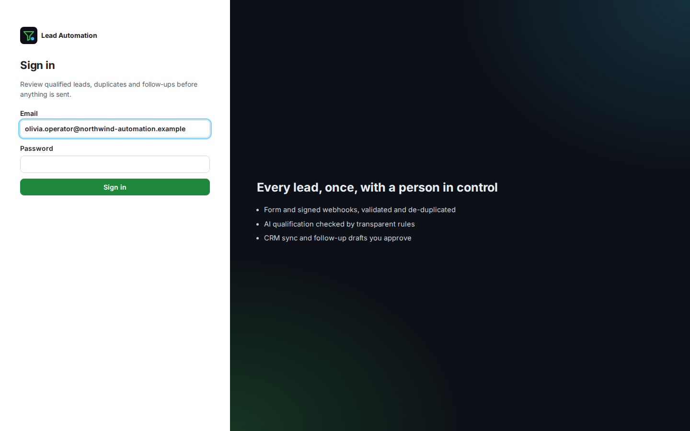 | **01 · Sign-in.** Operator accounts with roles (viewer, operator, admin); Argon2id passwords, short-lived tokens. |
| 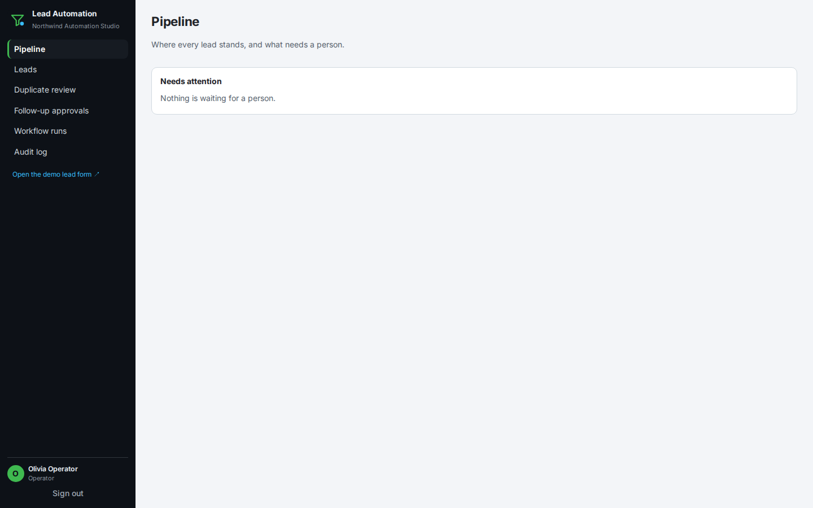 | **02 · Pipeline dashboard.** Leads by stage, what needs attention (reviews, drafts, failed or dead workflow events). |
| 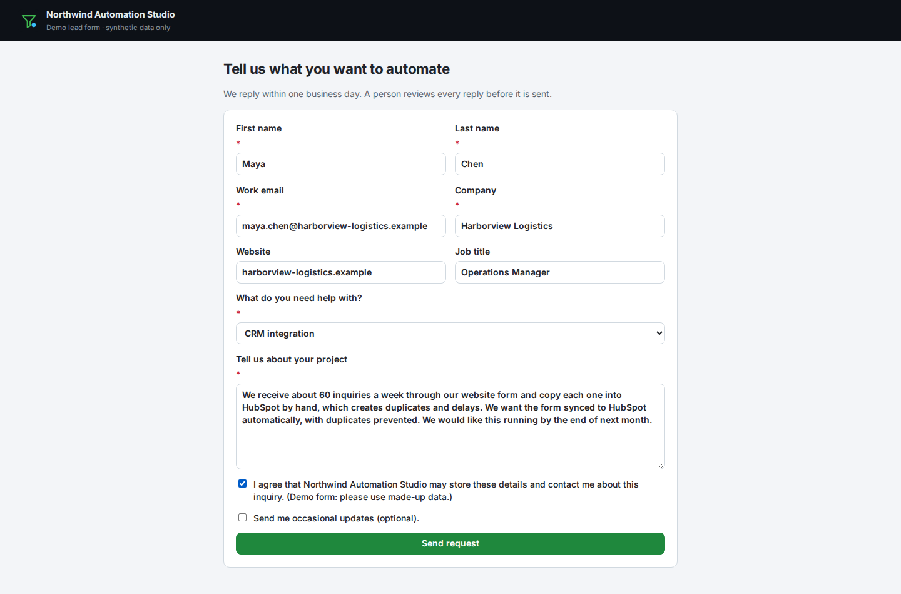 | **03 · Public lead form.** Validation, required consent with a versioned text, hidden honeypot. |
| 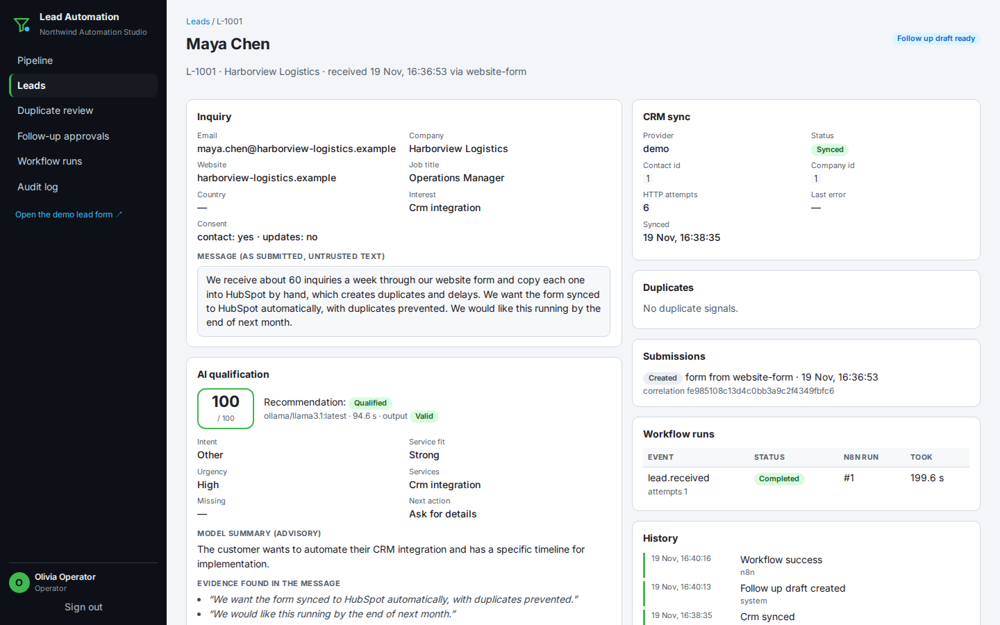 | **04 · AI qualification.** Score and decision from deterministic rules; the model's intent, fit, urgency and summary are advisory; evidence quotes are checked against the message. |
| 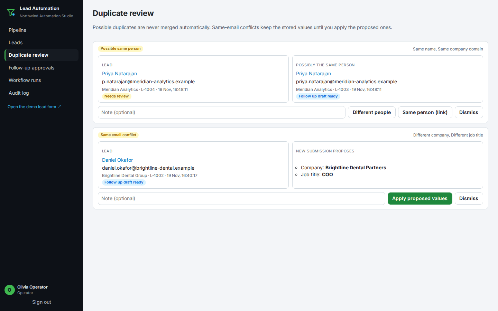 | **05 · Duplicate review.** Same name at the same company domain, or the same email with conflicting details: held for a person, never merged automatically. |
| 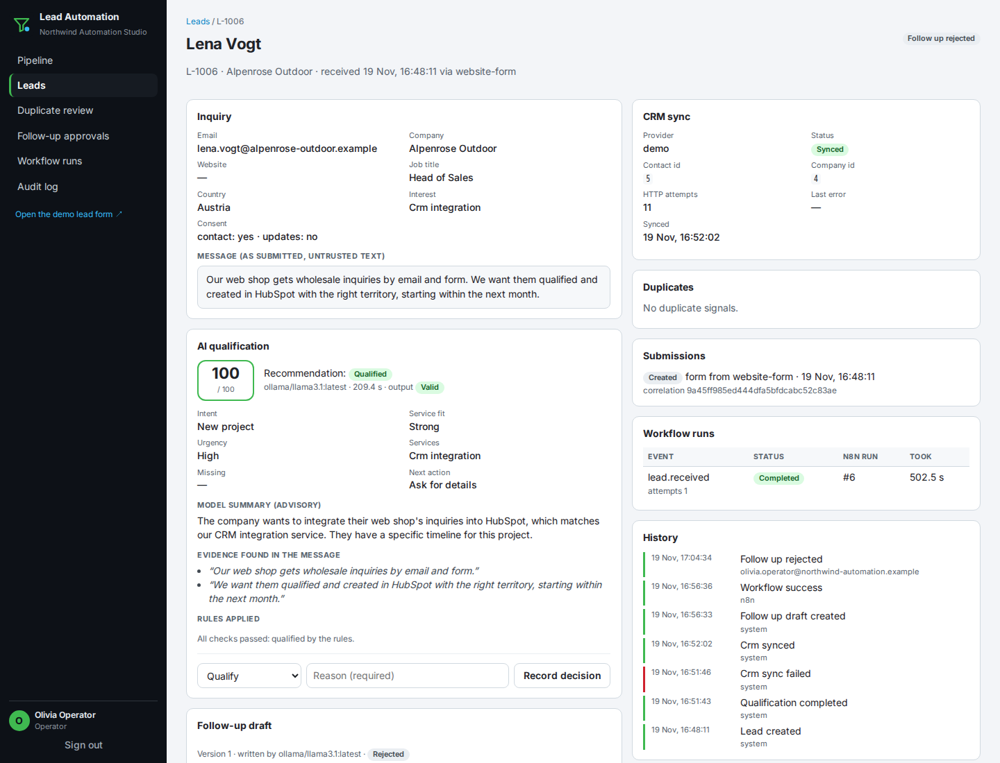 | **06 · CRM sync.** Contact and company ids, attempts (including the injected outage that was retried), last error. |
| 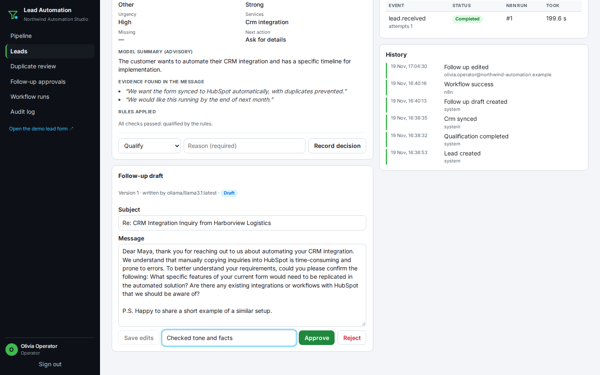 | **07 · Follow-up approval.** The operator edits the draft and approves or rejects it; nothing is sent before that. |
| 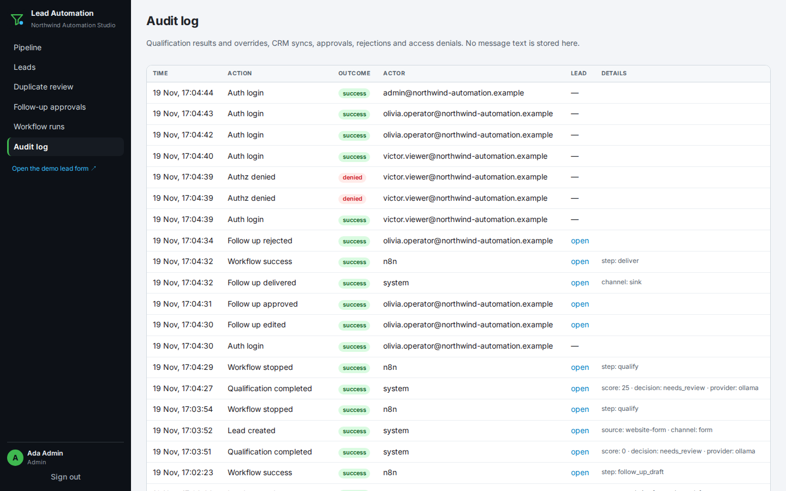 | **08 · Audit log.** Decisions, edits, approvals, deliveries, retries, rejected webhooks, denied access. |
| 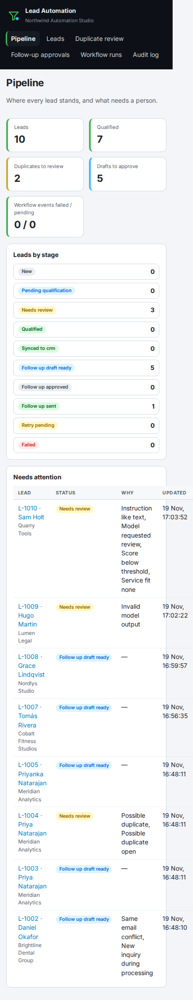 | **12 · Mobile layout.** The dashboard at 390 px wide. |

## n8n

| | |
|---|---|
| 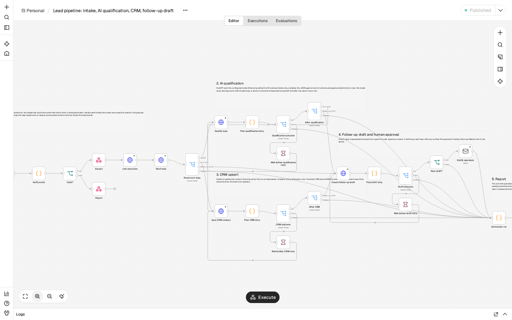 | **09 · Lead pipeline workflow.** Verify the signed event, ask the API for the next step, qualification / CRM / draft with retry loops (Wait nodes), notify, report the outcome. |
| 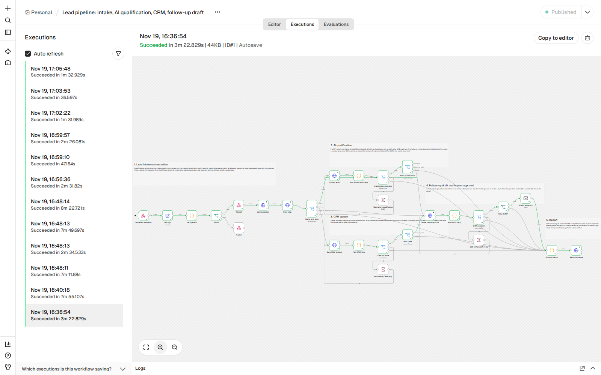 | **10 · A successful execution** of a real lead. |
| 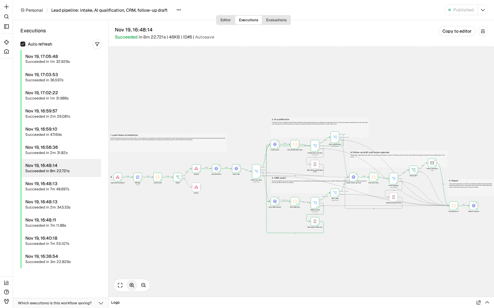 | **11 · Retry handling.** The CRM was made to fail (503) for the first calls: the run waited with backoff and called again, ending with exactly one contact. |

## Test evidence

See [assets/test-evidence/](../assets/test-evidence/) for the recorded test runs (unit and
integration tests with coverage, workflow harness, end-to-end scenarios, benchmark summary).
