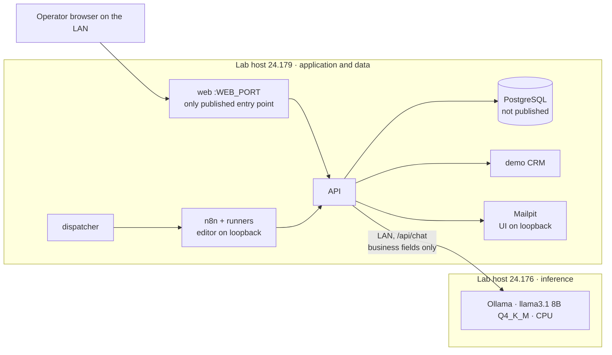

# Two-host deployment

The lab deployment uses two Debian 12 machines on a private LAN, called here by their lab
labels **`24.179`** (application and data plane) and **`24.176`** (model inference plane). Both
also run unrelated workloads, which constrained the design. Host names, full addresses and
other tenants are intentionally not recorded in this repository.

## Why this split

| Option | Decision |
|---|---|
| Model on `24.176` | Yes. It already serves `llama3.1` on the LAN; inference is the heaviest workload and keeps `24.179` responsive |
| Application + PostgreSQL + n8n on `24.179` | Yes. Docker Compose with a unique project name (`lead-automation`), its own networks and volumes |
| The prompt's preferred split (app on `24.176`, data on `24.179`) | Not used: `24.176` is a Kubernetes control plane whose ports (3000, 5432, 6379, 8000) are taken by unrelated services, and the account there cannot manage its firewall. Putting PostgreSQL on a LAN port only to cross hosts adds exposure without benefit at this scale |
| HTTPS | Not possible: no domain. LAN-only, documented as a lab deployment |

For dedicated machines, the split variant is: PostgreSQL listening on a private interface only,
`hostssl` + `scram-sha-256` in `pg_hba.conf` restricted to the application host's address,
`sslmode=verify-full` from the API, and the firewall allowing 5432 from that host only.

## Shared model host

The Ollama instance is shared with another lab application that calls it every few minutes.
Ollama reloads the model whenever a request asks for different runner options (`num_ctx`,
`num_thread`), so mismatched clients make every call pay a model reload: in this lab,
qualification calls took 3-5 minutes while the two clients alternated. The Ollama log shows the
other client's runner options (`KvSize 8192`, `NumThreads 8`); this deployment now sends the same
(`LEAD_LLM_NUM_CTX=8192`, `LEAD_LLM_NUM_THREAD=8`), so both share one loaded runner. The
benchmark's model-host CPU samples include the other application's load.

## Procedure followed

1. Resolved both hosts through the existing SSH configuration with strict host-key checking;
   no addresses guessed, no scans, no changes to SSH, firewall, routing or DNS.
2. Inspected OS, CPU, RAM, disk, Docker, listening ports and running containers on both hosts.
3. Generated secrets on `24.179` (`scripts/init-secrets.sh`, files `0644` in a `0700`
   directory owned by the deploying user) and wrote `.env` there; neither is in the repository.
4. `docker compose up -d --build --wait`, then the demo accounts.
5. Verification, backup/restore test and rollback test (below).

## Deployment record

Filled in from the actual verification run; see the section below for the commands.

| Item | Value |
|---|---|
| Application commit | _recorded at deployment_ |
| Images | `lead-automation-api:local`, `lead-automation-web:local` (built on the host from that commit); n8n 2.45.6, runners 2.45.6, PostgreSQL 17.11, Mailpit 1.29.6 pinned by digest |
| Model | `llama3.1:latest` (8.0B, Q4_K_M), Ollama on `24.176` |
| Exposure | web on the LAN interface; n8n editor and Mailpit UI on loopback; PostgreSQL, API, n8n webhooks, demo CRM internal only |
