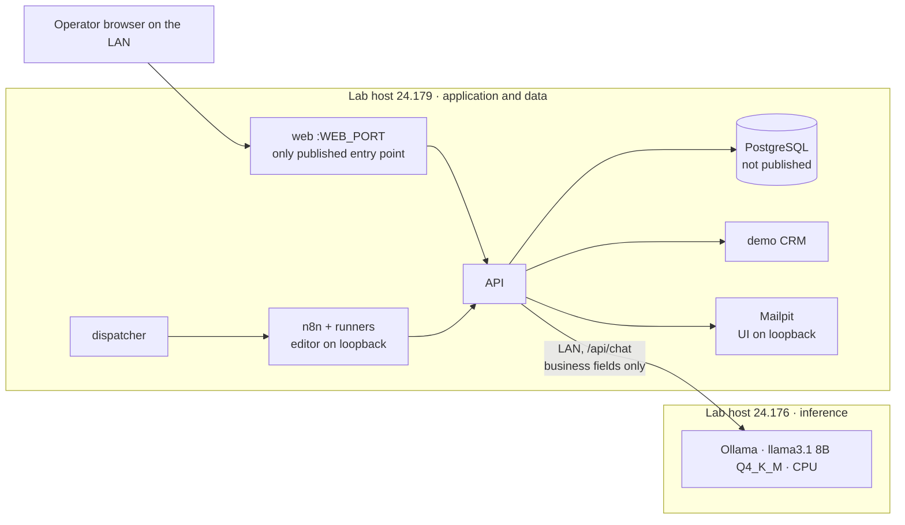

# Two-host deployment

The lab deployment uses two Debian 12 machines on a private LAN, called here by their lab
labels **`24.179`** (application and data plane) and **`24.176`** (model inference plane). Both
also run unrelated workloads, which constrained the design. Host names, full addresses and
other tenants are intentionally not recorded in this repository.



## Why this split

| Option | Decision |
|---|---|
| Model on `24.176` | Yes. It already serves `llama3.1` on the LAN; inference is the heaviest workload and keeps `24.179` responsive |
| Application + PostgreSQL + n8n on `24.179` | Yes. Docker Compose with a unique project name (`lead-automation`), its own networks and volumes |
| The prompt's preferred split (app on `24.176`, data on `24.179`) | Not used: `24.176` is a Kubernetes control plane whose ports (3000, 5432, 6379, 8000) are taken by unrelated services, and the account there cannot manage its firewall. Putting PostgreSQL on a LAN port only to cross hosts adds exposure without benefit at this scale |
| HTTPS | Not possible: no domain. LAN-only, documented as a lab deployment |

For dedicated machines, the split variant is: PostgreSQL listening on a private interface only,
`hostssl` + `scram-sha-256` in `pg_hba.conf` restricted to the application host's address,
`sslmode=verify-full` from the API, and the firewall allowing 5432 from that host only.

## Shared model host

The Ollama instance is shared with another lab application that calls it every few minutes.
Ollama reloads the model whenever a request asks for different runner options (`num_ctx`,
`num_thread`), so mismatched clients make every call pay a model reload: in this lab,
qualification calls took 3-5 minutes while the two clients alternated. The Ollama log shows the
other client's runner options (`KvSize 8192`, `NumThreads 8`); this deployment now sends the same
(`LEAD_LLM_NUM_CTX=8192`, `LEAD_LLM_NUM_THREAD=8`), so both share one loaded runner. The
benchmark's model-host CPU samples include the other application's load.

## Procedure followed

1. Resolved both hosts through the existing SSH configuration with strict host-key checking;
   no addresses guessed, no scans, no changes to SSH, firewall, routing or DNS.
2. Inspected OS, CPU, RAM, disk, Docker, listening ports and running containers on both hosts.
3. Generated secrets on `24.179` (`scripts/init-secrets.sh`, files `0644` in a `0700`
   directory owned by the deploying user) and wrote `.env` there; neither is in the repository.
4. `docker compose up -d --build --wait`, then the demo accounts.
5. Verification, backup/restore test and rollback test (below).

## Deployment record

Filled in from the actual verification run on 2026-11-19 (21:52-22:04 UTC); the commands are in
the next section.

| Item | Value |
|---|---|
| Application commit | `8aace5c` (the server copy is synced from that commit; `.env` and `secrets/` never leave the host) |
| Images | `lead-automation-api:local` (`sha256:e82e2f03…`), `lead-automation-web:local` (`sha256:0954b0cc…`), built on the host from that commit; n8n 2.45.6, runners 2.45.6, PostgreSQL 17.11, Mailpit 1.29.6 pinned by digest |
| Configuration | `compose.yaml` only (no evaluation overlay): `LEAD_ENVIRONMENT=production`, fault injection off in the API and the demo CRM, model-written drafts on, delivery to the sink |
| Model | `llama3.1:latest` (8.0B, Q4_K_M), Ollama on `24.176`, same runner options as the other client |
| Exposure (checked with `ss` and `curl` from the host) | web on the LAN interface (health 200); n8n editor and Mailpit UI on 127.0.0.1 only (no answer on the LAN address); PostgreSQL, API, n8n webhooks and demo CRM not published |
| Data | the synthetic benchmark and test leads (no real lead data) |
| Smoke test | passed: one lead, the replay recognised, an identical resubmission ignored, one workflow run, one CRM contact, no message before approval; qualified with a model-written draft in under 9 minutes on the shared CPU model host |
| Backup + restore check | passed: three dumps with checksums; restored into scratch databases, row counts equal (118 leads, 131 lead events, 771 audit events, 129 outbox events), 3 n8n workflows, 68 CRM contacts |
| Rollback test | passed: the running images tagged `:rollback`, stack started on them (all healthy, web health 200), then back on `:local` (all healthy, health 200). Both tags held the same build, so this verifies the procedure, not a version change |

## Verification run

On `24.179`, in the repository directory:

```bash
docker compose -f compose.yaml -f compose.eval.yaml down
```

```bash
docker compose up -d --build --wait
```

```bash
scripts/create-demo-users.sh
```

```bash
e2e/smoke.sh
```

```bash
scripts/backup.sh
```

```bash
scripts/restore.sh --check backups/<stamp>
```

```bash
for i in api web; do docker tag lead-automation-$i:local lead-automation-$i:rollback; done
```

```bash
LEAD_API_IMAGE=lead-automation-api:rollback LEAD_WEB_IMAGE=lead-automation-web:rollback docker compose up -d --wait
```

```bash
docker compose up -d --wait
```

Before the switch, `.env` lost the benchmark-only `LEAD_LLM_DRAFT_FOLLOWUPS=false` line and
`WEB_BIND` was set to the LAN interface's address (kept only in the host's `.env`). The demo
accounts already existed from the benchmark, so the user script reported conflicts and changed
nothing.
